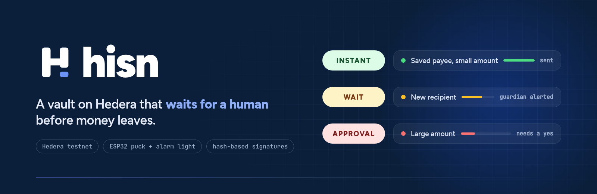
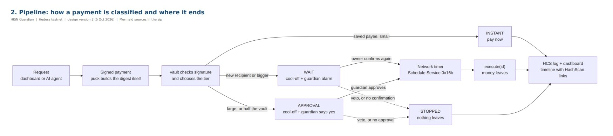
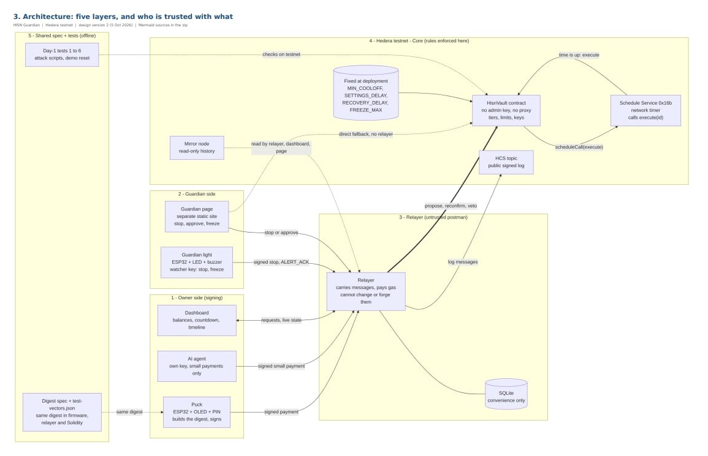
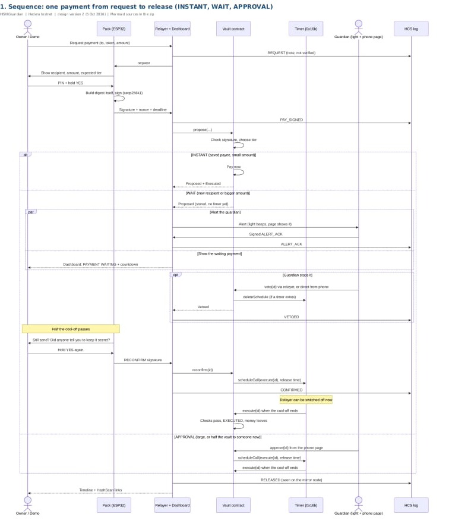

<p align="center">
  
</p>

<p align="center">
  <a href="https://ahmedd-ben-salah.github.io/hisn-vault/pitch/">Pitch deck</a> &nbsp;·&nbsp;
  <a href="https://ahmedd-ben-salah.github.io/hisn-vault/">Dashboard</a> &nbsp;·&nbsp;
  <a href="https://ahmedd-ben-salah.github.io/hisn-vault/guardian/">Guardian page</a> &nbsp;·&nbsp;
  <a href="https://ahmedd-ben-salah.github.io/hisn-vault/verify/">Verify a payment</a> &nbsp;·&nbsp;
  <a href="docs/HARDWARE_RESULTS.md">Hardware test run</a> &nbsp;·&nbsp;
  <a href="docs/README.md">Design docs</a>
</p>

<p align="center">
  
  
  
  
</p>

---

Most payment scams do not break anything. The victim is talked into sending the money themselves, usually in a hurry, and usually told to keep it quiet. Once the transfer is signed, the bank, the wallet and the blockchain all do exactly what they were told.

**Hisn** (Arabic for *fortress*) puts time and a second person between that moment of pressure and the money leaving. It is a smart-contract vault on Hedera, a small hardware puck that signs payments, and an alarm light that sits in someone else's home. Everyday payments go out at once. Anything unusual waits, rings the alarm, and asks again.

The rules live in the contract and the release is run by the Hedera network itself. Our server only carries messages: it cannot move the money, speed a payment up, or hold one back.

## How a payment is decided

| Tier | When | What happens |
|---|---|---|
| **INSTANT** | A saved payee, within the small daily allowance | Sent in the same transaction. |
| **WAIT** | A new recipient, or a bigger amount | Held for a cool-off. The guardian's light turns red and beeps, and the guardian can stop it from the light or the phone. Then the puck asks **STILL SEND?** and tells the owner to press No if anyone asked them to keep it secret. Without that second yes, nothing leaves. |
| **APPROVAL** | Above the waiting limit, or more than half the vault to someone new | Nothing leaves until a guardian approves it, after calling the owner. |

When a waiting payment is confirmed, the vault books its own release with the Hedera **Schedule Service** (HIP-755). At the release time the network executes it, whether or not any of our software is still running. This was tested with the relayer switched off ([`SERVER_OFF_PROOF.md`](docs/SERVER_OFF_PROOF.md)).

<p align="center">
  
</p>

## The pieces

| | Where | Role |
|---|---|---|
| **Puck** | `firmware/` | ESP32 with an OLED screen, three buttons and a PIN. It builds the payment digest itself and shows what is really being signed, so a compromised phone or dashboard cannot change the amount or the recipient behind the owner's back. |
| **Alarm light** | `firmware/` | ESP32 with an LED, a buzzer and one button, kept by the guardian. Hold 2 s to stop a payment, 5 s to freeze the whole account. It can say no; it can never say yes. |
| **Vault** | `contracts/` | `HisnVault.sol`. Holds HBAR and USDC, checks every signature, applies the tiers and limits, and schedules its own release. No admin key, no proxy, no upgrade path. |
| **Relayer** | `backend/` | Pays gas, talks to the devices over WebSocket, indexes the mirror node and writes every signed message to a public HCS topic. Treated as untrusted throughout. |
| **Dashboard** | `dashboard/` | The owner's screens: balance, waiting payments with a countdown, history with HashScan links, and an optional helper agent that may pay saved payees within a small allowance. |
| **Guardian page** | `guardian/` | A static page for the guardian's phone: stop, approve, freeze. It signs locally and can go straight to the contract if the relayer is down. |
| **Verify page** | `verify/` | Reads the vault's rules, its payments and the public log straight from the mirror node, with a link to the raw data behind every line. Nothing on it comes from our server. |
| **Mobile app** | `mobile/` | Expo app for Android with the owner and guardian views in one place. |
| **Shared spec** | `shared/` | Message digests, token table and test vectors. The same vectors are checked by the Solidity tests, the relayer and the firmware. |

## Who is trusted with what

<p align="center">
  
</p>

| Party | Can | Cannot |
|---|---|---|
| Owner, with the puck and PIN | Propose payments, confirm them a second time, cancel, freeze | Skip the wait or the guardian on an unusual payment |
| Guardian | Stop a payment, approve a large one, freeze | Move money, or approve anything that was not proposed by the owner's puck |
| Alarm light | Stop, freeze | Approve |
| Helper agent | Pay saved payees within its own small allowance | Pay anyone new, or exceed its limit |
| Relayer (our server) | Carry signed messages, pay gas, keep a convenience database | Forge or change a signature, release early, block a release already booked with the network |
| Anyone | Read the vault, the schedule and the public log | Anything else |

The delays that matter (shortest cool-off, settings delay, recovery delay, freeze length) are `immutable` in the contract. No setting, key or upgrade can shorten them after deployment.

## Hedera services

| Service | Used for |
|---|---|
| Smart Contract Service | The vault, its tiers and limits, and on-chain signature checks |
| Schedule Service (HIP-755) | The vault schedules its own `execute(id)`; the network fires it at the release time |
| Token Service | The vault associates and holds a fungible token for USDC payments |
| Consensus Service | An ordered, timestamped public log of every signed device message |
| Mirror node | History for the dashboard, the guardian page and the verify page |

A protected payment that waits and is then released by the network costs about **$0.155** in fees end to end, measured on testnet ([`HEDERA_NUMBERS.md`](docs/HEDERA_NUMBERS.md)).

## Quantum-resistant signatures

Every action of the puck that can move money or change the rules is signed twice: once with ECDSA, and once with a **WOTS+ one-time signature** under a Merkle tree of 256 keys (an XMSS-style construction built only from Keccak-256). The vault stores the tree's root and refuses the classical-only path while it is set. Forging a payment would need breaking ECDSA *and* the hash function. The puck builds the tree once, in about two minutes on the ESP32, and keeps it in flash. Details and limits: [`QUANTUM.md`](docs/QUANTUM.md).

## Proven on testnet, with the real devices

| | On testnet |
|---|---|
| Vault | [`0.0.10963657`](https://hashscan.io/testnet/contract/0xc066F10988733ea7875817cDC8d4bF098615A061) |
| Public log | [`0.0.10963660`](https://hashscan.io/testnet/topic/0.0.10963660) |
| Stablecoin | tUSDC `0.0.10885973`, a fixed-supply testnet stand-in for USDC |

On the built puck and light, on battery and Wi-Fi: an instant payment, a waiting payment stopped from the light, a freeze, a waiting payment released by the network's schedule with our relayer switched off, a large payment released only after a guardian approved it, and both devices recovering on their own after the server went away. Every step has a HashScan link in [`HARDWARE_RESULTS.md`](docs/HARDWARE_RESULTS.md).

Earlier runs: [`DAY1_RESULTS.md`](docs/DAY1_RESULTS.md) (feasibility), [`SECURITY_CHECKS.md`](docs/SECURITY_CHECKS.md) (attacks against the live vault), [`RECOVERY_TEST.md`](docs/RECOVERY_TEST.md) (replacing a lost puck).

<details>
<summary><b>Full sequence: one payment from request to release</b></summary>
<br>
<p align="center">
  
</p>
</details>

## Running it

Needs Node 20 or newer. PlatformIO for the firmware.

### Locally, no Hedera account needed

```bash
npm ci
npm test
npm run local
```

`npm run local` starts a local chain with stand-ins for the Hedera precompiles and the mirror node, deploys the vault and writes `.env.local`. Then, in two more terminals:

```bash
npm run relayer:local
npm run sim:local
```

The relayer listens on `http://localhost:8787` and `sim:local` connects a simulated puck and light.

`npm -w backend run e2e:local` plays the whole story against them: an instant payment, a waiting payment with its second confirmation, a guardian stop, a guardian-approved payment, a settings change and a freeze.

### On Hedera testnet

1. Copy `.env.example` to `.env`. Fill `RELAYER_ACCOUNT_ID` and `RELAYER_PRIVATE_KEY` with an ECDSA testnet account from [portal.hedera.com](https://portal.hedera.com), and set `RELAYER_API_TOKEN` to a long random string.
2. Optional: `npm -w contracts exec tsx scripts/make-test-usd.ts` creates your own tUSDC and writes `USDC_ADDRESS`.
3. `npm -w contracts run deploy:testnet` deploys and funds the vault, associates the token and creates the HCS topic. Device addresses come from `PUCK_ADDRESS`, `GUARDIAN_ADDRESSES` and `WATCHER_ADDRESSES`; simulated keys are generated if they are empty.
4. `npm run relayer`, then `npm -w backend run sim` for simulated devices, or flash the real ones (below).

### The devices

```bash
cd firmware
pio run -e puck -t upload
pio run -e light -t upload
```

Each device creates its own key on first start and prints its address on the serial console. `npm run redeploy:devices -- --puck 0x… --light 0x… --pq-root 0x…` then deploys a vault bound to those keys. Wiring, console commands and the simulator builds are in [`firmware/README.md`](firmware/README.md).

### Useful commands

| Command | What it does |
|---|---|
| `npm run demo:check` | Pre-flight check: relayer, vault funds, freeze state, both devices online with the right keys, public log, clock |
| `npm run demo:reset` | Close waiting payments and top the vault back up |
| `npm -w contracts run security` | Attack checks against the deployed vault |
| `npm -w contracts run proof:server-off` | A waiting payment released by Hedera with the relayer stopped |
| `npm -w contracts run recovery-test` | Lost-puck recovery on a throwaway vault |
| `npm -w contracts run hedera-numbers` | Fees and counts per protected payment, from the mirror node |

## Repository

```
contracts/    HisnVault and the hash-based signature verifier, Hardhat tests, deploy and check scripts
backend/      relayer, mirror-node indexer, device hub, helper agent, local chain and device simulator
shared/       digests, token table and cross-language test vectors
firmware/     PlatformIO project for the puck and the light, native tests, Wokwi scenarios
dashboard/    owner web app (Vite, React)
guardian/     guardian phone page
verify/       public verification page
mobile/       Android app (Expo)
docs/         design, threat model, test results
handoff/      design system: colours, type, screens, logo
```

## Limits

This is testnet software written in one week and it has not been audited. The relayer is a single process and the devices reach it over local Wi-Fi. Some keys stay classical: the guardian's, the light's and the helper agent's, as listed in [`QUANTUM.md`](docs/QUANTUM.md). The threat model and the answers to every attack we could think of are in [`07-threat-model.md`](docs/07-threat-model.md) and [`12-red-team-fixes.md`](docs/12-red-team-fixes.md); what we chose not to build is in [`11-not-built.md`](docs/11-not-built.md).

## Team

Ahmed Ben Salah · Mohamed Amine Ayari · Anas Abd Elmalek Cherif · Mohamed Aziz Abbes

## Licence

MIT. See [`LICENSE`](LICENSE).
