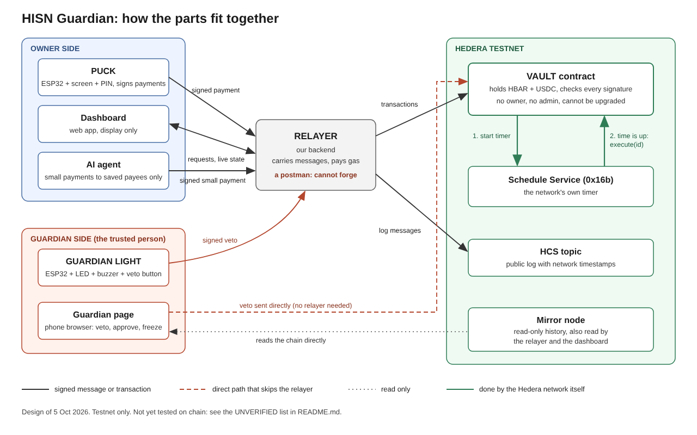

# HISN, a slow account on Hedera

HISN is a vault for people who are likely targets of payment scams. Small payments to saved people go out at once. Bigger payments, or payments to someone new, wait. During the wait a guardian gets a physical alarm and can stop the payment with one button, and the owner confirms it a second time on a hardware puck. Once confirmed, **the Hedera network itself releases the payment** through the Schedule Service, so no server of ours can speed it up or hold it back.



## What runs where

| Part | Folder | What it does |
|---|---|---|
| Vault contract | `contracts/` | Holds HBAR and USDC, applies the tiers, cool-off, guardian stop, freeze and settings changes. Schedules its own release with HIP-755. |
| Relayer | `backend/` | Pays gas, talks to the devices over WebSocket, watches the mirror node, posts every signed message to an HCS topic. It cannot move money on its own. |
| Shared code | `shared/` | Message digests, token table and test vectors used by the contract tests, relayer and firmware. |
| Firmware | `firmware/` | ESP32 puck (screen, three buttons, PIN, signs payments) and guardian light (LEDs, buzzer, stop button). See `firmware/README.md`. |
| Dashboard and guardian page | `dashboard/`, `guardian/` | The owner's web screens and the guardian's phone page. |

## Hedera services used

- **Smart Contract Service** for the vault (`HisnVault.sol`), whose admin key is the contract itself.
- **Schedule Service** (HIP-755): the vault schedules its own `execute`, and the network fires it at the release time.
- **Token Service**: the vault associates and holds a fungible token for USDC payments.
- **Consensus Service**: a public, ordered log of every signed device message.

## Testnet deployment

Recorded in `deployments/testnet.json`.

| Item | Value |
|---|---|
| Vault | `0.0.10896159` ([HashScan](https://hashscan.io/testnet/contract/0x3839360e141259E886cA406e8a76bBC89Aa03B1b)) |
| Public log topic | `0.0.10896165` ([HashScan](https://hashscan.io/testnet/topic/0.0.10896165)) |
| Demo stablecoin | tUSDC `0.0.10885973`, a fixed-supply testnet stand-in for USDC (Circle's testnet faucet did not deliver on Hedera) |

Results: `docs/DAY1_RESULTS.md` (Day-1 feasibility tests), `docs/SECURITY_CHECKS.md` (security checks on the live vault), `docs/SERVER_OFF_PROOF.md` (release with our server off) and `docs/RECOVERY_TEST.md` (lost-puck recovery).

## Run it locally in 10 minutes

Needs Node 20 or newer.

```bash
npm ci
npm test
npm run local
```

`npm run local` starts a local chain with a stand-in for the Hedera precompiles and mirror node, deploys the vault and writes `.env.local`. Then, in two more terminals:

```bash
npm run relayer:local
npm run sim:local
```

The relayer listens on `http://localhost:8787`, and `sim:local` connects a simulated puck and light. `npm -w backend run e2e:local` runs the whole story against them: instant payment, waiting payment with a second confirmation, a guardian stop, a guardian-approved payment, a settings change and a freeze.

## Run it on testnet

1. Copy `.env.example` to `.env` and fill `RELAYER_ACCOUNT_ID` and `RELAYER_PRIVATE_KEY` with an ECDSA testnet account from [portal.hedera.com](https://portal.hedera.com). Set `RELAYER_API_TOKEN` to a long random string.
2. Optional: `npm -w contracts exec tsx scripts/make-test-usd.ts` creates your own tUSDC and writes `USDC_ADDRESS`.
3. `npm -w contracts run deploy:testnet` deploys and funds the vault, associates the token and creates the HCS topic. Device addresses come from `PUCK_ADDRESS`, `GUARDIAN_ADDRESSES` and `WATCHER_ADDRESSES`. If they are empty, simulated keys are generated.
4. `npm run relayer` and `npm -w backend run sim`, then `npm -w backend run e2e:testnet:usdc` (or `e2e:testnet` for HBAR).

| Command | What it does |
|---|---|
| `npm -w contracts run day1 -- <1-5>` | One Day-1 feasibility test on testnet |
| `npm -w contracts run security` | Security checks against the deployed vault, written to `docs/SECURITY_CHECKS.md` |
| `npm -w contracts run proof:server-off` | With the relayer stopped: a puck-signed waiting payment is released by Hedera's scheduler, evidence in `docs/SERVER_OFF_PROOF.md` |
| `npm -w contracts run recovery-test` | Lost-puck recovery on a throwaway vault, results in `docs/RECOVERY_TEST.md` |
| `npm run redeploy:devices -- --puck 0x… --light 0x…` | New vault with the real device keys (the guardian page stays second guardian), funded and reset; backs up `.env` to `.backups/` |
| `npm -w contracts run hedera-numbers` | Fees and counts per protected payment from the mirror node, written to `docs/HEDERA_NUMBERS.md` |
| `npm run demo:check` | Pre-stage check: relayer, vault funds and freeze, both devices online with the right keys, public log, clock, language model |
| `npm run demo:reset` | Closes waiting payments and tops the vault back up to 40 HBAR and 2,000 USDC |
| `npm -w contracts test` | Contract test suite |

## Security

Threat model and known limits: `docs/07-threat-model.md` and `docs/12-red-team-fixes.md`. This is testnet software built in a week and has not been audited.

## Licence

MIT, see `LICENSE`.
