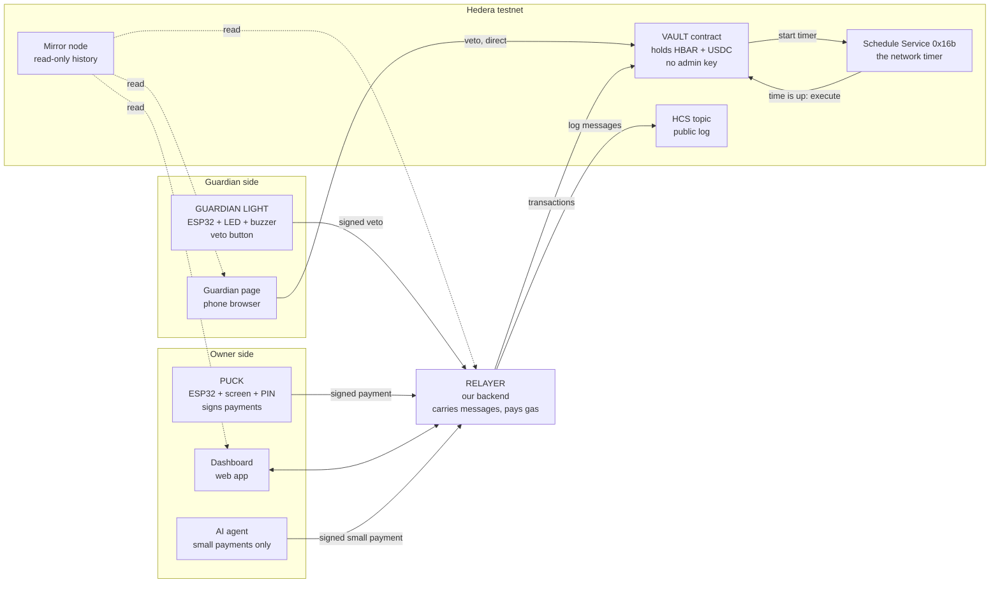

# 01. Architecture

## The big picture

See `diagrams/trust-layers.jpg` and `diagrams/architecture.svg` for the image versions.

## The parts, in plain words

| Part | What it is | What it is trusted with |
|---|---|---|
| **Vault** | One Solidity contract. Holds the money and enforces every rule. | Everything. It has no owner and cannot be upgraded. |
| **Puck** | The owner's device. Shows recipient and amount, asks for the PIN, signs. | The owner's signing key. |
| **Guardian light** | The trusted person's device. Flashes and beeps when a payment is waiting. One button vetoes. | A guardian signing key. |
| **Guardian page** | A phone web page with the same veto and approve buttons. | A second guardian key, kept in the phone browser. |
| **Relayer** | Our Node.js backend. Takes signed messages, sends them to the vault, pays gas, posts to HCS, pushes alerts. | **Nothing about money.** It can delay or drop messages, but it cannot change or forge them. |
| **Schedule Service** | A system contract built into Hedera at address `0x16b`. The vault asks it: "call my `execute(id)` at this second." | It is part of the network. |
| **HCS topic** | A public message log. Each message gets a network timestamp and an order. | Ordering and timestamps. |
| **Mirror node** | A free read-only copy of Hedera history, reached by HTTPS. | Reading only. |
| **Dashboard** | A React web app: balances, pending payments with countdown, timeline, HashScan links. | Nothing. It only displays. |
| **AI agent** | A small program with an LLM. It has its own key, which the vault honours only for small payments to saved payees. | A tiny daily allowance, enforced by the vault. |

## Version 2 notes (after the red-team review)

- The **guardian light** holds a *watcher* key: it can stop and freeze, never approve or recover.
- The **guardian page** is a separate static site, not served by the relayer.
- The **relayer** holds one key: the AI agent's. Its theft is worth the agent's daily allowance and nothing more.
- A waiting payment needs the owner's **second confirmation** before the vault starts the network timer. Nothing leaves on silence.
- We say "our server cannot move or block money", not "no company in the middle".

## The one design rule

**The vault checks signatures, so the relayer does not have to be trusted.**

A payment is accepted only if the puck signed exactly that recipient, token and amount. A veto is accepted only if a guardian key signed it (or sent it directly). The relayer in the middle is a postman.

What a bad or broken relayer **can** do: refuse to deliver. Our answers:

- A dropped **payment** harms nobody; the money stays put.
- A dropped **veto** would be dangerous, so the guardian page can send the veto straight to Hedera without the relayer.
- A dropped **alert** would also be dangerous, so the guardian page reads the mirror node directly, and for big payments silence does not release anything.
- A dead relayer **after** a payment is scheduled changes nothing: the network releases it. This is the "unplug the laptop" demo.

## Who talks to whom

| From | To | How | Why |
|---|---|---|---|
| Puck, guardian light | Relayer | WebSocket over Wi-Fi (JSON) | Receive payment requests and alerts, send signatures |
| Dashboard | Relayer | HTTPS + WebSocket | Create requests, show live state |
| Relayer | Vault | JSON-RPC (Hashio, chain id 296) with ethers | Send transactions |
| Relayer | HCS | Hedera SDK (`@hashgraph/sdk`) | Post log messages |
| Relayer, dashboard, guardian page | Mirror node | HTTPS REST | Read contract events and HCS messages |
| Guardian page | Vault | JSON-RPC directly, from the phone | Veto without the relayer |
| Vault | Schedule Service | Solidity call to `0x16b` | Start or cancel the timer |
| Schedule Service | Vault | The network calls `execute(id)` | Release the payment |

## Two vaults, on purpose

- **`HisnVault`**: the real product and the whole demo. Standard signatures only.
- **`HisnVaultPQ`** (COULD tier): a tiny separate vault that shows a hash-based one-time signature. A bug in it cannot touch the main demo.
