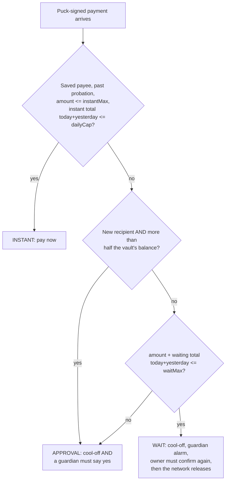

# 02. Smart contract: `HisnVault` (version 2, after the red-team review)

One contract, one file, no proxy, no owner, no upgrade. Solidity `^0.8.24`, OpenZeppelin `ECDSA` and `ReentrancyGuard` only.

> **What changed in version 2.** A hostile review on 5 Oct found that one guardian key could take the whole vault, that silence released money, that a guardian could freeze forever, and several counter and replay gaps. Every rule marked **(v2)** below is a fix. The full list is in `12-red-team-fixes.md`.

## Why it is built this way

| Decision | Reason |
|---|---|
| No admin key, no owner, no `selfdestruct` | Nobody, including us, can take the money or change the code. |
| No proxy and no `delegatecall` anywhere | Scheduling from inside a `delegatecall` fails on Hedera (open issue #27263). |
| `execute(id)` can be called by **anyone** | The network timer calls it. If the timer ever fails, a person can press a button. Same function, same checks. |
| The delays that protect settings are fixed forever | Term Finance lost $8.5M on 23 Aug 2026 because its cooldown could be set to zero ([write-up](https://defiprime.com/term-finance-governance-exploit)). Ours cannot. |
| Standard ECDSA signatures only | No custom cryptography in a contract that can never be fixed. |
| **(v2)** Nothing leaves on silence | Scammers coach victims to wait out a timer. A waiting payment now needs a second, later confirmation. |
| **(v2)** No single key other than the puck can ever gain the power to pay | A stolen guardian phone must not be enough to take the vault. |

## Money units (easy to get wrong)

| Asset | Token key in the contract | Decimals | Note |
|---|---|---|---|
| HBAR | `address(0)` | 8 (tinybars) | Inside the contract, `msg.value` and `call{value}` use **tinybars**. In ethers transactions sent through the relay, `value` has **18** decimals. Convert in the relayer, never in the contract. |
| USDC | `0x0000000000000000000000000000000000068cDA` (token 0.0.429274) | 6 | Used through the normal ERC-20 `transfer`. |

## The four kinds of key (v2)

| Role | Who holds it | Can do | Can never do |
|---|---|---|---|
| **Puck** | The owner's device | Sign payments, confirm them again, cancel, freeze, propose changes | Skip the wait or the guardian |
| **Guardian** | A trusted person's phone. Up to 4. At least 1; **2 recommended**. | Stop a payment, approve a large payment, freeze, approve or stop a change, co-sign a puck recovery | Pay, be a payee, recover the puck alone |
| **Watcher** | The alarm light. Up to 4. | Stop a payment, stop a change, freeze | Approve anything, start or co-sign a recovery |
| **Agent** | The AI helper | Small payments to saved payees inside its allowance | Everything else |

**(v2)** All keys must be different from each other. A guardian or watcher address can never be added as a payee.

## Fixed at deployment (immutable)

| Name | Demo value | Suggested real value | Meaning |
|---|---|---|---|
| `USDC` | address above | same | The only token besides HBAR |
| `MIN_COOLOFF` | 60 s | 1 h | The cool-off can never go below this |
| `SETTINGS_DELAY` | 300 s | 48 h | Wait before any settings change |
| `RECOVERY_DELAY` | 600 s | 7 days | Wait before a lost-device recovery |
| `APPROVAL_WINDOW` | 1800 s | 24 h | How long a waiting payment stays alive after its release time |
| **(v2)** `FREEZE_MAX` | 600 s | 72 h | A freeze ends by itself after this, unless renewed |
| **(v2)** `PROBATION` | 0 s | 30 days | A newly saved payee cannot receive instant payments until this has passed |
| **(v2)** `MAX_PENDING` | 5 | 5 | Most waiting payments allowed at once |
| **(v2)** `MAX_DEADLINE` | 600 s | 600 s | A signed message is rejected if its deadline is further away than this |
| `GAS_RESERVE` | 10 HBAR | tune | HBAR that payments may never touch, kept to pay for scheduled calls |
| `EXEC_GAS` | 1,000,000 | tune on Day 1 | Gas given to the scheduled `execute` (UNVERIFIED U4) |

## Changeable state (only through the delayed process below)

```solidity
address public puck;
address[] public guardians;                   // 1..4, full guardians (phones)
address[] public watchers;                    // 0..4, stop-and-freeze only (alarm lights)
address public agent;                         // address(0) = no agent
uint32  public coolOff;                       // seconds, >= MIN_COOLOFF (demo 60 on stage, 180 default)
uint64  public frozenUntil;                   // frozen while block.timestamp < frozenUntil
address public lastFreezer;
uint32  public epoch;                         // +1 on every freeze; kills waiting payments
uint32  public keyEpoch;                      // +1 on every freeze and every key change; kills waiting changes

struct Limits { uint128 instantMax; uint128 waitMax; uint128 dailyCap; uint128 agentDailyMax; }
mapping(address => Limits) public limits;     // per token
mapping(address => uint64)  public payeeSince; // 0 = not a payee

mapping(address => mapping(uint256 => uint256)) public instantSpent; // token => day => total
mapping(address => mapping(uint256 => uint256)) public waitQueued;   // token => day => total
mapping(address => mapping(uint256 => uint256)) public agentSpent;   // token => day => total
mapping(bytes32 => bool) public usedDigest;   // replay protection
uint256 public pendingCount;                  // <= MAX_PENDING
```

Demo limits: USDC `instantMax` 50, `waitMax` 500, `dailyCap` 100, `agentDailyMax` 20 (times 10^6). HBAR the same numbers (times 10^8).

**(v2) Rolling limits.** Every limit check adds **today and yesterday** together. This stops someone from sending the cap at 23:59 and again at 00:01.

## Payments

```solidity
enum Tier   { INSTANT, WAIT, APPROVAL }
enum Status { NONE, PENDING, EXECUTED, VETOED, CANCELLED, EXPIRED }

struct Payment {
  address to; address token; uint128 amount;
  uint64 proposedAt; uint64 releaseAt; uint64 expiresAt; uint32 epoch;
  Tier tier; Status status;
  bool confirmed;          // WAIT: the owner confirmed again. APPROVAL: a guardian approved.
  address schedule;        // Hedera schedule address, or address(0)
}
```

### How the tier is chosen (v2)



- **(v2) Half-the-vault rule.** A big payment to someone new looks like "move your money to a safe wallet", the most common way victims are talked out of a protected account. It always needs a guardian.
- **(v2) WAIT replaces SILENT.** Doing nothing now cancels the payment.

### The life of a WAIT payment (v2)

| Step | When | Who | What |
|---|---|---|---|
| 1 | t = 0 | Owner on the puck | Signs. The vault stores the payment. Guardians and watchers are alerted. **No timer yet.** |
| 2 | from t = cool-off / 2 | Owner on the puck | Sees the payment again with one question ("Has anyone told you to keep this secret or told you what to say?") and holds YES to confirm. |
| 3 | on confirmation | Vault | Starts the network timer for `releaseAt`. If `releaseAt` has already passed, pays now. |
| 4 | t = cool-off | Hedera network | Calls `execute`. The money leaves. |
| any time before step 4 | | Guardian or watcher | One press stops it. |
| if step 2 never happens | `expiresAt` | Nobody | The payment is dead. Nothing was sent. |

Why half the cool-off: the owner has had time to hang up the phone, and the guardian has had time to look.

### Functions

| Function | Who may call | What must be true | What it does |
|---|---|---|---|
| `receive()` | anyone | | Accepts HBAR deposits. |
| `associateToken()` | anyone | | Calls `associate()` on the USDC address. Safe to call twice. |
| `propose(to, token, amount, nonce, deadline, sig)` | anyone (the relayer) | Puck signature over the PAY digest; not frozen; `deadline` not passed and **(v2)** `deadline <= now + MAX_DEADLINE`; digest unused; token is HBAR or USDC; amount > 0; **(v2)** `pendingCount < MAX_PENDING` unless the tier is INSTANT | Picks the tier. INSTANT pays now. WAIT and APPROVAL store the payment and wait. Returns the id. |
| **(v2)** `reconfirm(id, nonce, deadline, sig)` | anyone | Puck signature over the RECONFIRM digest; payment is PENDING, tier WAIT, not confirmed, same epoch; `now >= proposedAt + coolOff / 2`; not expired | Sets `confirmed`. Starts the timer for `releaseAt`, or pays now if that time has passed. |
| `approve(id, sig)` | a **guardian** directly or by signature (not a watcher) | PENDING, tier APPROVAL, not confirmed, not expired | Sets `confirmed`. Starts the timer, or pays now if the cool-off is over. |
| `execute(id)` | **anyone**, including the network timer | PENDING; same epoch; not frozen; `confirmed`; `now >= releaseAt`; `now <= expiresAt` | Sets EXECUTED, then sends the money. |
| `veto(id, sig)` | a guardian or watcher, directly or by signature | PENDING | Sets VETOED, deletes the timer, **(v2)** gives the amount back to `waitQueued`, lowers `pendingCount`. |
| `cancel(id, sig)` | anyone carrying the puck's signature | PENDING | Sets CANCELLED; same clean-up as veto. |
| `agentPay(to, token, amount, nonce, deadline, sig)` | anyone | Agent signature; `to` is a saved payee past probation; agent total today+yesterday within `agentDailyMax`; not frozen; deadline rules as above | Pays now. Anything outside these rules reverts. |
| `freeze(sig)` | puck, guardian or watcher, directly or by signature over the FREEZE digest | | `frozenUntil = now + FREEZE_MAX`, `epoch += 1`, `keyEpoch += 1`, deletes the timers of all waiting payments (at most `MAX_PENDING`). |
| **(v2)** `renewFreeze(sig)` | puck, guardian or watcher **other than `lastFreezer`** | currently frozen | Extends by `FREEZE_MAX`. One person alone cannot keep the account frozen. |

### Rules inside every function that pays (v2: all of them, not only `execute`)

1. Change the status **first**, send money **after** (plus `nonReentrant`).
2. HBAR: require `address(this).balance - amount >= GAS_RESERVE`, then `to.call{value: amount}("")`.
3. USDC: `IERC20(USDC).transfer(to, amount)` and require it returned true.
4. If the transfer fails, the whole call reverts and the payment stays PENDING. The dashboard shows **Retry** until `expiresAt`.

## The network timer (HIP-1215)

```solidity
interface IHederaScheduleService {
  function scheduleCall(address to, uint256 expirySecond, uint256 gasLimit,
                        uint64 value, bytes memory callData)
      external returns (int64 responseCode, address scheduleAddress);
  function deleteSchedule(address scheduleAddress) external returns (int64 responseCode);
  function hasScheduleCapacity(uint256 expirySecond, uint256 gasLimit)
      external view returns (bool);
}
IHederaScheduleService constant HSS = IHederaScheduleService(address(0x16b));
int64 constant SUCCESS = 22;
```

```solidity
function _schedule(uint256 id, uint64 releaseAt) internal returns (address sched) {
  if (address(this).balance < GAS_RESERVE) { emit ScheduleFailed(id); return address(0); } // v2
  bytes memory data = abi.encodeCall(this.execute, (id));
  uint256 when = uint256(releaseAt) + 5;            // slack, see U5
  for (uint256 i = 0; i < 8; i++) {                 // 8 tries in total: when, when+1, ... when+7
    (bool ok, bytes memory ret) = address(HSS).call(
      abi.encodeCall(HSS.scheduleCall, (address(this), when + i, EXEC_GAS, 0, data)));
    if (ok && ret.length >= 64) {
      (int64 rc, address s) = abi.decode(ret, (int64, address));
      if (rc == SUCCESS) return s;
    }
  }
  emit ScheduleFailed(id);                          // payment still PENDING; manual execute works
  return address(0);
}
```

- **(v2) The timer is started only after confirmation**, so a payment nobody confirms never costs the vault any gas.
- The vault calls `0x16b` with a normal call. Never route it through another contract.
- A problem in the timer never blocks a payment from being recorded. The worst case is "someone must press Execute".
- `deleteSchedule` is wrapped the same way. A veto never depends on the delete succeeding: if the timer still fires, `execute` reverts because the status is VETOED.
- The relayer gives `propose`, `reconfirm` and `approve` a high gas limit (start with 3,000,000) because scheduling is expensive (UNVERIFIED U4).

## Settings changes: always slow, and never blind (v2)

```solidity
enum ChangeKind { ADD_PAYEE, REMOVE_PAYEE, SET_LIMITS, SET_COOLOFF, SET_AGENT,
                  ADD_GUARDIAN, REMOVE_GUARDIAN, ADD_WATCHER, REMOVE_WATCHER, UNFREEZE,
                  RECOVER_PUCK }
struct Change { ChangeKind kind; bytes data; uint64 readyAt; uint64 expiresAt;
                address proposer; address approver; uint32 keyEpoch; Status status; }
```

| Kind | Who proposes | Also needed | Wait | Who can stop it |
|---|---|---|---|---|
| `REMOVE_PAYEE`, `REMOVE_WATCHER` | puck | nothing | none | (they only make things safer) |
| `ADD_PAYEE`, `SET_LIMITS`, `SET_COOLOFF`, `SET_AGENT`, `ADD_GUARDIAN`, `ADD_WATCHER`, `UNFREEZE` | puck | one guardian's yes | `SETTINGS_DELAY` | any guardian or watcher; puck |
| `REMOVE_GUARDIAN` with another guardian's yes | puck | a **different** guardian's yes | `SETTINGS_DELAY` | puck; the other guardians. The guardian being removed cannot block it. |
| `REMOVE_GUARDIAN` with nobody else's yes | puck | nothing | **2 x `RECOVERY_DELAY`** | Nobody can block it, but every guardian and watcher alarms for the whole wait. |
| **(v2)** `RECOVER_PUCK(newPuck)` | a guardian | a **second, different guardian's** yes | `RECOVERY_DELAY` | the old puck; any guardian or watcher |

Functions: `proposeChange(kind, data, nonce, deadline, sig)`, `approveChange(id, sig)`, `vetoChange(id, sig)`, `executeChange(id)` (anyone, after `readyAt`, before `expiresAt`).

Extra rules:

- **(v2)** With only one guardian, `RECOVER_PUCK` is impossible. That is on purpose: one stolen phone must not be able to become the owner. Setup tells the owner this and recommends a second guardian.
- **(v2)** A change is dead if `keyEpoch` has moved since it was proposed. A freeze or any key change wipes all waiting changes.
- **(v2)** The digest for a change signs the kind and the **decoded fields**, not a hash of opaque data, so the puck can show what is being changed (see `03` and `05`).
- **(v2)** `ADD_PAYEE` and the key-adding kinds revert if the new address is already a puck, guardian, watcher or agent.
- `SET_COOLOFF` reverts below `MIN_COOLOFF`. Removing the last guardian reverts.
- The immutable values have no change kind.
- Settings changes are not put on the network timer (saves HBAR). The dashboard shows an "Apply" button when one is ready.

**Honest trade-off.** The owner can always remove a guardian alone after a long wait. Without that, a hostile guardian could trap her. With it, a patient scammer can coach her to do it, but it takes two weeks (real values) with every alarm sounding.

## Events

```solidity
event Proposed(uint256 indexed id, address indexed to, address token, uint256 amount,
               Tier tier, uint64 releaseAt, uint64 confirmFrom);
event Confirmed(uint256 indexed id, address indexed by, address schedule);   // reconfirm or approve
event Executed(uint256 indexed id, address indexed to, address token, uint256 amount, address caller);
event Vetoed(uint256 indexed id, address indexed by);
event Cancelled(uint256 indexed id);
event AgentPaid(address indexed to, address token, uint256 amount);
event ScheduleFailed(uint256 indexed id);
event Frozen(address indexed by, uint32 newEpoch, uint64 until);
event FreezeRenewed(address indexed by, uint64 until);
event ChangeProposed(uint256 indexed id, ChangeKind kind, bytes data, uint64 readyAt, address proposer);
event ChangeApproved(uint256 indexed id, address indexed by);
event ChangeVetoed(uint256 indexed id, address indexed by);
event ChangeExecuted(uint256 indexed id, ChangeKind kind);
```

## Errors

`BadSignature`, `Expired`, `DeadlineTooFar`, `Replayed`, `IsFrozen`, `BadToken`, `ZeroAmount`, `NotPending`, `TooEarly`, `NotConfirmed`, `OldEpoch`, `NotGuardian`, `NotPayee`, `OnProbation`, `OverAgentLimit`, `TooManyPending`, `BelowGasReserve`, `TransferFailed`, `BelowMinCoolOff`, `LastGuardian`, `KeyAlreadyUsed`, `SameApprover`, `NotReady`.

## HBAR the vault needs

| Use | Amount | Note |
|---|---|---|
| Gas reserve for scheduled calls | 10 HBAR locked, top up to 30 for demo day | Real cost per scheduled call is measured on Day 1 (U4) |
| Demo funds | whatever the demo sends | Testnet faucet HBAR |

The relayer's own account pays for `propose`, `reconfirm`, `veto`, `approve` and the HCS messages. Fund it with at least 100 testnet HBAR.

## Constructor

```solidity
constructor(address puck_, address[] memory guardians_, address[] memory watchers_,
            address agent_, address usdc_, uint32 coolOff_, Immutables memory im_,
            Limits memory hbarLimits_, Limits memory usdcLimits_, address[] memory payees_) payable
```

It checks that every key is different, that there is at least one guardian, and that no payee is a key. It does **not** call `associate()` (U8); the deploy script calls `associateToken()` right after.

## Local testing without Hedera

`0x16b` and the USDC token do not exist on a local Hardhat chain. Use `hardhat_setCode` to place:

- `MockScheduleService` at `0x16b`: stores `(to, when, data)`, returns `(22, fakeAddress)`, has a test-only `fire(scheduleAddress)`, and a flag that makes it fail.
- `MockUSDC`: a 6-decimal ERC-20 with an `associate()` that returns 22.

Tests that must exist for the v2 rules: one guardian cannot recover the puck; two can; a watcher cannot approve; an unconfirmed WAIT payment never executes; `reconfirm` before half the cool-off reverts; a veto restores `waitQueued`; the midnight double-spend is blocked; a far-future deadline reverts; a freeze ends at `FREEZE_MAX`; the same key cannot renew its own freeze; a waiting change dies after a freeze; a guardian cannot be added as a payee; the sixth waiting payment reverts.

## Post-quantum layer (`HisnPQVerifier`)

Built after all, as a hybrid layer in the main vault: `proposePQ`, `reconfirmPQ` and `proposeChangePQ` need the puck's hash-based signature as well as ECDSA once `pqRoot` is set. See `docs/QUANTUM.md`.

## Implementation notes (as built)

- `EXPIRED` status: a waiting payment past `expiresAt` is closed by `expire(id)` (anyone) or automatically when the next payment is proposed, so it never blocks one of the `MAX_PENDING` slots.
- A freeze closes every waiting payment as `CANCELLED`, gives the waiting totals back and deletes their timers, instead of leaving them in an old epoch.
- `renewFreeze` signs action 12 (`RENEW_FREEZE`) over the current `epoch` and `frozenUntil`, so a captured renewal cannot be replayed later.
- `REMOVE_GUARDIAN`: the puck can cancel it; another guardian (not the target) can withdraw an approval, which sends it back to the slow `2 x RECOVERY_DELAY` path; the target and watchers cannot block it.
- Views for the relayer and dashboard: `tierFor(to, token, amount)`, `spendable(token)`, `windows(token)`, `getPayment`, `getChange`, `getPendingIds`, `getGuardians`, `getWatchers`, `getPayees`, `isFrozen`, `digestFor(action, fields)`.
- A payment to any key address (puck, guardian, watcher, agent) is refused.
