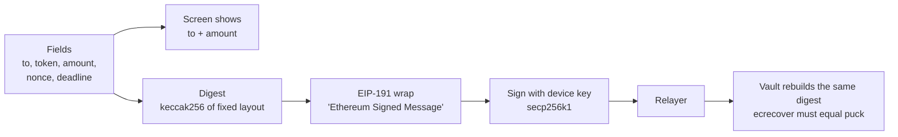

# 03. Signing scheme, message formats, data model and HCS log

## The idea in one picture



The puck builds the digest **itself**, from the same bytes it puts on the screen. It never signs a ready-made hash from the relayer. That is how we avoid blind signing.

## Digest layout

Every signed action uses the same shape. All values are 32-byte words, as produced by Solidity `abi.encode`.

```
digest = keccak256( abi.encode( TAG, chainId, vault, action, ...fields ) )
signed = keccak256( "\x19Ethereum Signed Message:\n32" ++ digest )
```

- `TAG = keccak256("HISN_V1")`
- `chainId = 296` (Hedera testnet). The contract uses `block.chainid`.
- `vault` = the vault's address. A signature for one vault is useless on another.

| `action` | Name | Signed by | Fields after `action` |
|---|---|---|---|
| 1 | PAY | puck | `to` (address), `token` (address), `amount` (uint256), `nonce` (uint256), `deadline` (uint256) |
| 2 | AGENT_PAY | agent | same as PAY |
| 3 | VETO | guardian | `paymentId` |
| 4 | CANCEL | puck | `paymentId` |
| 5 | APPROVE | guardian | `paymentId` |
| 6 | FREEZE | puck or guardian | `epoch` (the current one) |
| 7 | CHANGE | puck, or guardian for `RECOVER_PUCK` | `kind` (uint8), `keyEpoch`, then the change's **own fields as words** (for example the payee address, or the four limit numbers), `nonce`, `deadline` |
| 8 | CHANGE_APPROVE | guardian | `changeId`, `kind`, `keccak256(data)` |
| 9 | CHANGE_VETO | guardian, watcher, or old puck for `RECOVER_PUCK` | `changeId` |
| 10 | ALERT_ACK | guardian or watcher | `paymentId`, `nonce` |
| 11 | RECONFIRM | puck | `paymentId`, `nonce`, `deadline` |
| 12 | RENEW_FREEZE | puck, guardian or watcher (not the last freezer) | `epoch`, `frozenUntil` (the current values, so an old renewal can never be replayed) |

Version 2 notes:

- **Changes are never signed blind.** The puck builds the CHANGE digest from fields it decodes and shows ("ADD PAYEE 0x5aAe...", "LIMIT 50 -> 200"). The guardian page decodes the change from the chain, not from the relayer, before it signs CHANGE_APPROVE.
- **Deadlines are capped.** The vault rejects any `deadline` more than 600 s in the future, so a wrong clock on the puck cannot create a signature that stays valid for days.
- **Watchers** (the alarm light) may sign only VETO, CHANGE_VETO, FREEZE and ALERT_ACK.

A PAY message is exactly 9 words = 288 bytes before hashing. The firmware fills a fixed 288-byte buffer; no dynamic encoding is needed.

## Signature format

- 65 bytes: `r` (32) ++ `s` (32) ++ `v` (1), with `v` = 27 or 28.
- `s` must be in the lower half of the curve order (OpenZeppelin `ECDSA.recover` rejects the rest).
- The ESP32 library returns only `r` and `s`. The **relayer** flips `s` if needed and finds `v` by trying 27 and 28 against the known device address. This is safe: the relayer cannot make a signature for different fields.

## Replay protection

| Threat | Protection |
|---|---|
| Same payment submitted twice | `usedDigest[digest]` is set on first use. `nonce` is 8 random bytes from the device. |
| Old signed payment submitted days later | `deadline` = signing time + 120 s. The vault rejects it afterwards. |
| Signature reused on another vault or network | `vault` and `chainId` are inside the digest. |
| Veto, approve or cancel replayed | They name one payment id, and that payment can leave PENDING only once. |
| Old freeze replayed after an unfreeze | The digest contains `epoch`, which grows by one at every freeze. |
| Old settings change replayed after a freeze or key change | The CHANGE digest contains `keyEpoch`, and waiting changes die when it moves. |
| Signature captured and held back for days | `deadline` must be within 600 s of the time it reaches the vault. |
| PAY signature used as AGENT_PAY, or the reverse | `action` is inside the digest. |

The puck needs the time for `deadline`. It reads it by NTP at boot. If NTP fails, the puck refuses to sign.

## What the puck screen must show (128x64 OLED)

```
+----------------------+
| !! NEW RECIPIENT !!  |   or the saved name, e.g. "Sami (son)"
| 100.00 USDC          |
| 0x5aAeb6F5..9d2A1BeAed|  first 8 and last 8 characters
| wait 3 min + guardian|   the tier the puck expects
| PIN: _ _ _ _         |
+----------------------+
```

- The **name** comes from the puck's own memory, never from the relayer. A name is stored as *inactive* when the puck signs the `ADD_PAYEE` change. It becomes active only after the change has been applied on chain **and** the owner confirms it once on the puck. If the change is stopped or expires, the puck deletes it. An inactive name is never shown; the puck shows `NEW RECIPIENT`.
- The third line is always the same sentence on a new-recipient payment: `HISN NEVER ASKS YOU TO MOVE MONEY`.
- If the address is not in the puck's list, the top line is always `NEW RECIPIENT`.
- The amount is formatted on the device from the raw integer and the token's decimals.
- A second screen (press NEXT) shows the full address in four lines.
- Honest limit: a name is a **saved label**, not a verified identity. We do no identity check.

## Data model

### On chain (the truth)

Everything in `02-smart-contract.md`: payments, changes, payees (addresses only), limits, keys.

### On the puck

| Item | Storage |
|---|---|
| Private key | NVS, encrypted with a key derived from the PIN |
| Payee list: address + label (max 16 chars), up to 20 entries | NVS |
| Vault address, chain id, token table | NVS, set at provisioning |
| Wrong-PIN counter | NVS |

### In the relayer (SQLite; convenience only, safe to lose)

| Table | Columns | Purpose |
|---|---|---|
| `requests` | id, to, token, amount, source (`dashboard` or `agent`), status, created_at | Payment requests waiting for the puck |
| `labels` | address, label | Names for the dashboard (copies of the puck's labels) |
| `devices` | device_id, role, address, last_seen | Which devices are online |
| `hcs_cursor` | topic_id, last_sequence | Where we are in the log |

If this database is deleted, no money is affected and the dashboard rebuilds itself from the mirror node.

## HCS topic design

### One topic per vault

- Created by the relayer at setup. Memo: `HISN:<vault address>`.
- **No submit key.** Anyone may post. This sounds risky, but every useful message carries a device signature, and readers ignore the rest. In exchange, the relayer cannot be accused of controlling the log. (The guardian page does not post to HCS itself in this version; its veto goes to the vault, and the vault's own event is the record.)
- Cost: $0.0008 per message. A full payment story is about 6 messages, under one cent.

### Message format (JSON, under 1,000 bytes)

```json
{
  "v": 1,
  "type": "VETO_SIGNED",
  "vault": "0x...",
  "ref": 12,
  "at": 1791644400,
  "body": { },
  "signer": "0x...",
  "sig": "0x...",
  "tx": "0.0.1234@1791644401.000000000"
}
```

| Field | Meaning |
|---|---|
| `type` | See the table below |
| `ref` | Payment id or change id (0 if none yet) |
| `at` | The sender's clock in seconds. Informational only; the trusted time is the HCS consensus timestamp. |
| `body` | The fields that were signed, so anyone can rebuild the digest |
| `signer`, `sig` | The device key and its signature, when the message comes from a device |
| `tx` | The Hedera transaction id, when the message reports a transaction |

### Message types

| Type | Posted when | Signed by | Why it matters |
|---|---|---|---|
| `REQUEST` | A payment is asked for (dashboard or agent) | none | Start of the story |
| `PAY_SIGNED` | The puck signed | puck | Proves the owner approved exactly these fields |
| `PROPOSED` | The `propose` transaction succeeded | none (has `tx`) | Links to HashScan |
| `ALERT_ACK` | The guardian light received the alert and started beeping | guardian | Proves the guardian was told, and when |
| `VETO_SIGNED` | The guardian pressed veto | guardian | **Timestamped before the release time** |
| `VETOED` | The `veto` transaction succeeded | none (has `tx`) | |
| `APPROVE_SIGNED`, `APPROVED` | Guardian said yes | guardian / none | |
| `RELEASED` | The relayer saw `Executed` on the mirror node | none (has `tx`) | Shows the caller was the network, not us |
| `FROZEN` | Freeze | puck or guardian | |
| `CHANGE_SIGNED`, `CHANGE_APPROVED`, `CHANGE_VETOED`, `CHANGE_APPLIED` | Settings changes | as in the digest table | Shows nobody quietly changed a rule |
| `AGENT_REFUSED` | The vault rejected an agent payment | none | Shows the limit was enforced on chain |

### Reader rules (dashboard and guardian page)

1. Ignore any message whose `vault` is not ours.
2. For signed types, rebuild the digest from `body`, recover the signer, and check on chain that it is the puck or a guardian. If not, ignore the message.
3. For types with `tx`, check the transaction on the mirror node. If it does not exist or failed, ignore the message.
4. Order by HCS consensus timestamp, never by `at`.
5. **Show only messages that are signed by a known key or backed by a real transaction.** `REQUEST` is neither, so it appears greyed as "note, not verified" or not at all. This keeps spam and fake stories out of the timeline.
6. Never show a person's name next to the public log. The log holds addresses only.

### What the log proves, honestly

- **Proves:** the order and time at which signed approvals, alerts and vetoes reached the network, in a log we cannot rewrite.
- **Does not prove:** who was holding the device, or that a recipient is who the label says.
- **Does not replace** the contract. The vault's own events are the truth about money; HCS adds the off-chain steps (alert delivered, button pressed) that a contract cannot see.

### Evidence export (COULD tier)

A dashboard button downloads one JSON file per payment: the HCS messages with consensus timestamps, the contract events, and HashScan links.
