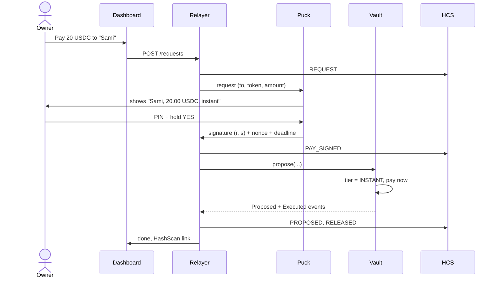
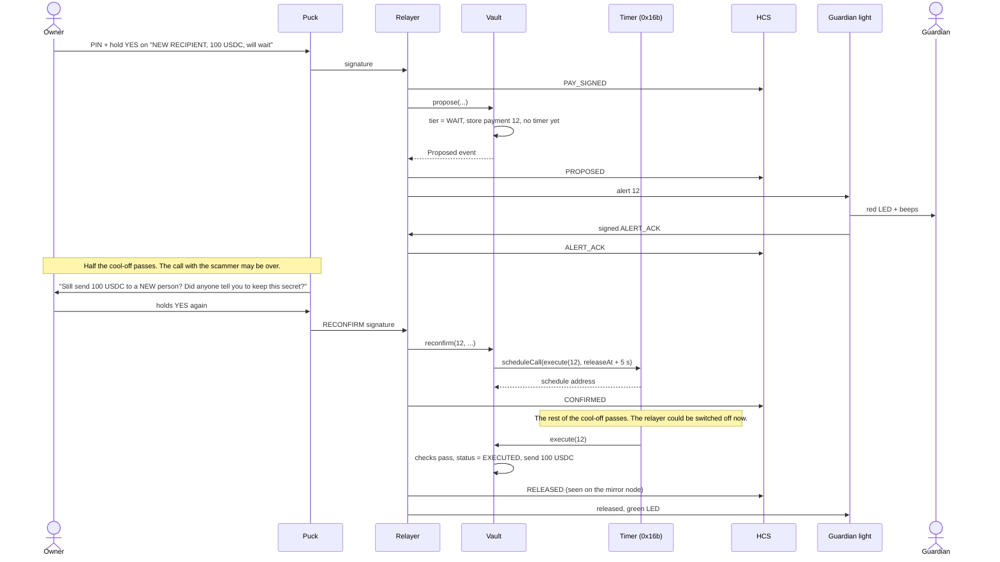
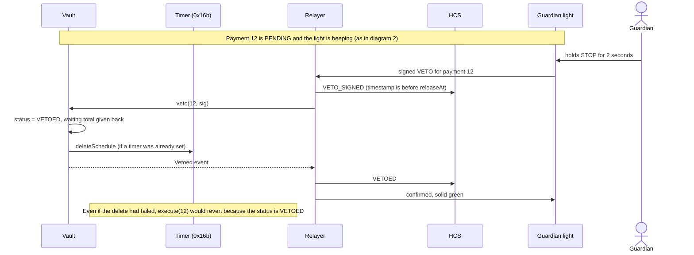
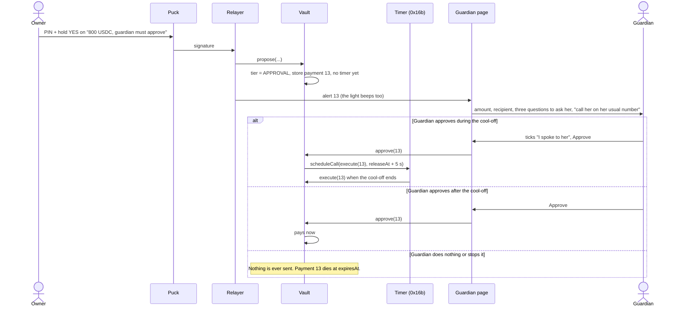
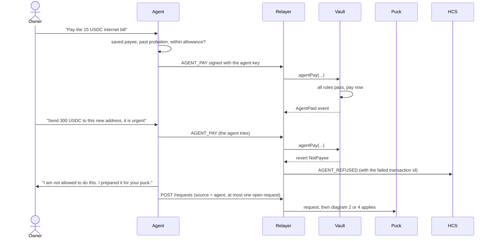
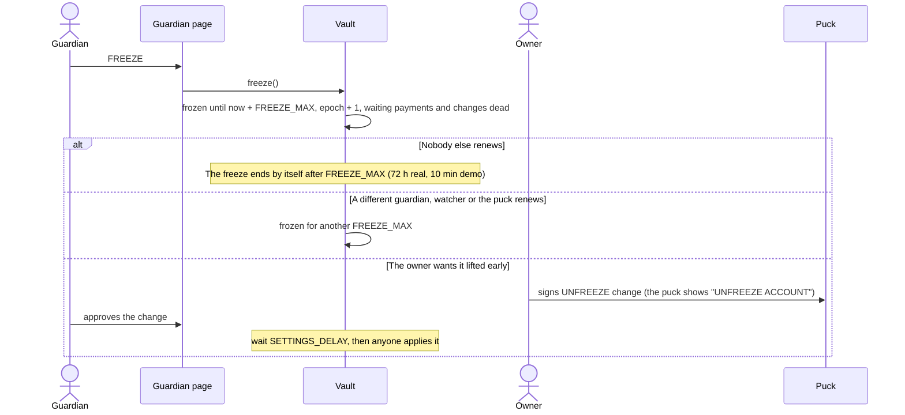
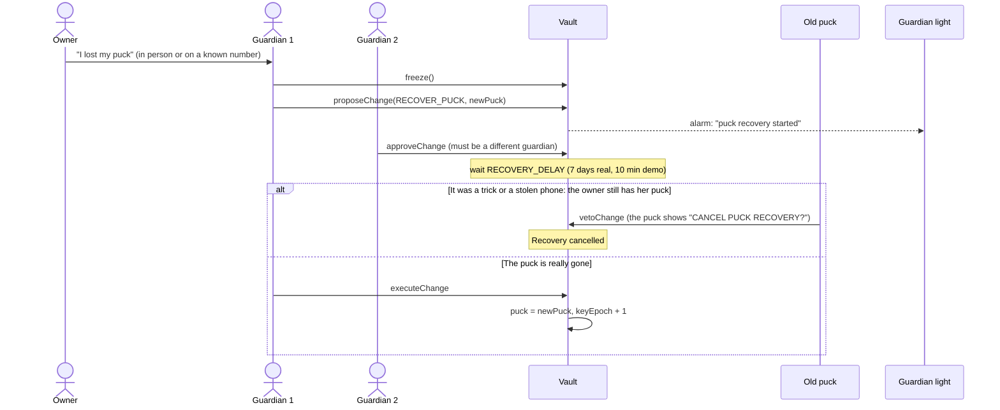
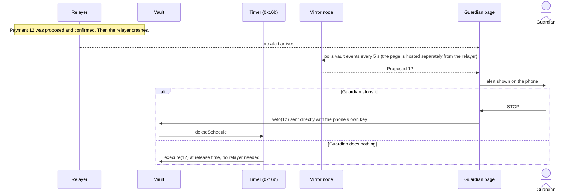

# 04. Sequence diagrams (version 2)

Read each diagram top to bottom. Each arrow is one message.

Actors: **Owner**, **Puck**, **Relayer**, **Vault**, **Timer** (Hedera Schedule Service), **HCS**, **Light** (the guardian's alarm light, a watcher key), **Guardian** (the trusted person), **Page** (the guardian's phone page), **Mirror** (mirror node).

Version 2 changes: a waiting payment needs a second confirmation from the owner before the network will release it; the light can stop but not approve; puck recovery needs two guardians.

## 1. Small payment to a saved payee (INSTANT)

## 2. New recipient or bigger amount (WAIT): confirm again, then the network releases

If the owner never confirms again, nothing is scheduled and nothing is sent. The payment dies at `expiresAt`.

## 3. The guardian stops it

The light turns green only when it sees the veto confirmed. It ignores any "all clear" it did not cause until the release time has passed.

## 4. Large payment, or most of the vault to someone new (APPROVAL)

The alarm light cannot approve. Only a guardian's phone can.

## 5. AI agent

The limit is enforced by the **vault**. If the agent's computer is hijacked, the most its key can do is the daily allowance to saved payees.

## 6. Freeze

One person alone cannot keep the account frozen forever.

## 7. The puck is lost or stolen (recovery needs two guardians)

With only one guardian, the puck cannot be recovered. Setup says so and recommends a second guardian.

## 8. The relayer fails

| What breaks | What happens |
|---|---|
| Relayer down **before** signing or before the second confirmation | No payment can be made. Nothing is at risk. |
| Relayer down **after** the second confirmation | The timer releases on time. The guardian page still sees it and can stop it. |
| Relayer drops a veto | The guardian uses the page, which goes straight to Hedera. |
| Timer refuses to schedule | The vault makes 8 tries. If all fail: `ScheduleFailed`, and anyone can press Execute after the cool-off. |
| Someone on the Wi-Fi sends the light a fake "all clear" | The light ignores it and stays red until the release time. |
| Guardian light offline | The guardian page is the backup. Nothing leaves on silence anyway. |
| Testnet slow or down | See the demo fallback in `09-test-and-demo-plan.md`. |
