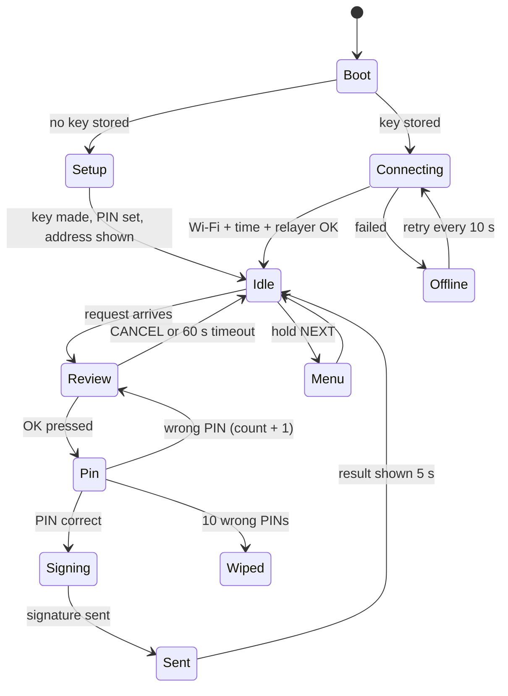
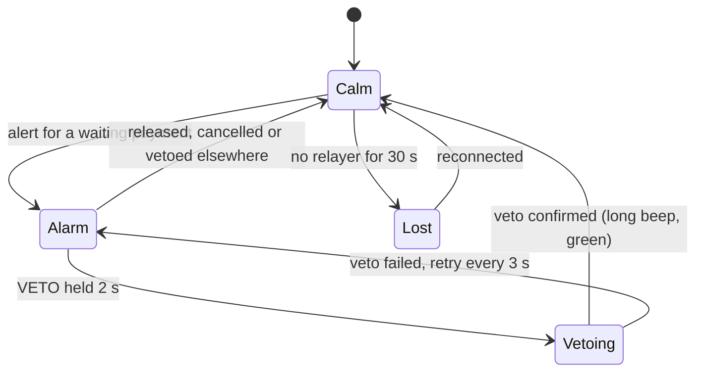

# 05. Firmware for the two ESP32 devices

Tooling: **PlatformIO**, Arduino framework, board `esp32dev` (change if your board differs). Both devices share one small library, `hisn_crypto`.

> Assumed hardware (please confirm, see README open question 1): ESP32 DevKit, SSD1306 128x64 OLED on I2C, three push buttons on the puck, one button plus LED plus buzzer on the guardian light.

## Shared library: `firmware/lib/hisn_crypto`

| Function | What it does | Built on |
|---|---|---|
| `keccak256(data, len, out32)` | Ethereum's hash | One small C file (for example the public-domain SHA3IUF in Keccak mode). **Not** the SHA3-256 in mbedTLS; the padding differs. |
| `hisn_digest_pay(...)`, `hisn_digest_id(action, id)`, `hisn_digest_freeze(epoch)`, `hisn_digest_change(...)` | Fill the fixed word layout from `03-signing-and-hcs.md` and hash it | `keccak256` |
| `eip191_wrap(digest, out32)` | Adds the "Ethereum Signed Message" prefix and hashes again | `keccak256` |
| `sign(hash32, privkey, out_r, out_s)` | secp256k1 signature | `micro-ecc` (`uECC_secp256k1`), random numbers from `esp_random()` after Wi-Fi is on |
| `address_from_privkey(priv, out20)` | Last 20 bytes of keccak256 of the public key | `micro-ecc` + `keccak256` |
| `format_amount(raw, decimals, out)` | "100.00" from 100000000 | plain C |

**Test vectors.** `shared/test-vectors.json` is generated once by a TypeScript script (ethers). It holds fixed private keys, fields, expected digests, wrapped hashes and addresses. The same file is checked by a native PlatformIO unit test, the contract tests and the backend tests. If all three agree, the device and the contract speak the same language. This is the most important test in the project (U11).

## Device 1: the PUCK

### Wiring (suggested pins)

| Part | Pin |
|---|---|
| OLED SDA / SCL | GPIO 21 / 22 |
| Button UP | GPIO 32 (to ground, internal pull-up) |
| Button NEXT | GPIO 33 |
| Button OK | GPIO 25 |
| Buzzer (optional) | GPIO 26 |

If you own a 4x4 keypad, use it for the PIN and keep OK and CANCEL as two keys.

### Screens

| Screen | Content |
|---|---|
| Setup | Makes a new key, asks for a 3-digit PIN twice (`HISN_PIN_LEN`), then shows the puck's address as text and QR code for the deploy script |
| Idle | "HISN ready", Wi-Fi bars, vault balance (from the relayer, display only) |
| Review | Layout from `03-signing-and-hcs.md`: name or `NEW RECIPIENT`, amount, short address, expected tier. NEXT shows the full address. |
| Pin | UP changes the digit, NEXT moves on, OK confirms |
| Sent | "Sent. Waiting 3 min." or "Paid." or the error text |
| Menu | FREEZE, cancel a waiting payment, show address, payee list |

### PIN entry with three buttons

Each digit starts at a **random** value, so someone watching the number of presses learns nothing.

### Key storage

1. At setup the puck makes a 32-byte private key with `esp_random()` (Wi-Fi on, so the hardware random source is active).
2. It derives a storage key from the PIN: SHA-256 repeated 50,000 times over `PIN + 16-byte random salt` (mbedTLS).
3. It stores `salt`, the AES-256-GCM encrypted key and the wrong-PIN counter in NVS.
4. To sign, it decrypts the key into RAM, signs, and wipes the RAM copy.
5. Ten wrong PINs in a row erase the key. The owner then uses recovery.

Honest limits: even a long PIN can be brute-forced by someone who reads the flash chip, because an ESP32 is not a secure element. The answer is in the product design, not the chip: a stolen key can only make instant payments inside the daily cap; everything else waits for the guardian, and the guardian can freeze. An ATECC608 chip is a COULD-tier upgrade.

### Signing a payment, step by step

1. Receive `request {reqId, to, token, amount}` from the relayer.
2. Check the token is HBAR or USDC from the built-in table. Otherwise show "UNKNOWN TOKEN" and refuse.
3. Look up `to` in the **local** payee list. Choose the name or `NEW RECIPIENT`.
4. Work out the expected tier with the locally stored limits (for display only; the vault decides).
5. Show Review. Wait for OK.
6. Ask for the PIN. Decrypt the key.
7. Make `nonce` (8 random bytes) and `deadline = now + 120`.
8. Build the PAY digest from the **same variables that were displayed**, wrap, sign.
9. Send `{reqId, nonce, deadline, r, s}`. Wipe the key from RAM.

### Failure modes

| Problem | Behaviour |
|---|---|
| No Wi-Fi | "OFFLINE" screen, retry. Nothing can be signed, nothing is at risk. |
| No NTP time | Refuse to sign ("NO CLOCK"). |
| Relayer unreachable | Same as offline. |
| Request while another is on screen | Queue one, reject the rest. |
| Power loss during signing | Nothing was sent; the request times out on the relayer. |
| Brown-out, garbage on screen | The watchdog reboots. A request is never signed without a fresh Review. |

## Device 2: the GUARDIAN LIGHT

### Wiring (suggested pins)

| Part | Pin |
|---|---|
| Red LED / green LED (or one RGB LED) | GPIO 18 / 19 |
| Buzzer | GPIO 26 |
| VETO button (big, red if possible) | GPIO 27 |
| Optional OLED | GPIO 21 / 22 |

### Behaviour

| State | LED | Buzzer |
|---|---|---|
| Calm | green, slow breathing | silent |
| Alarm, WAIT tier | red, blinking faster as time runs out | beep every 5 s, every 1 s in the last 30 s |
| Alarm, APPROVAL tier | red and green alternating | double beep every 10 s |
| Vetoing | red solid | continuous tone |
| Lost | yellow (both LEDs), slow blink | one beep per minute |

- **Veto** needs a 2-second hold, so a pocket press does nothing.
- **The light can never approve anything.** Its key is a *watcher* key: the vault accepts it only for stopping a payment, stopping a change, and freezing. Approving a large payment is done on the guardian's phone page, where the amount can be read.
- **The light also alarms when a settings change or a puck recovery is proposed** (a different beep pattern), and the same button stops it.
- **The light ignores any "clear" message it did not cause.** It stays red (dim, no beep) until the release time has passed or its own stop was confirmed. A fake "all clear" on the Wi-Fi cannot silence it.
- The light **has no PIN**. A veto can only stop money, never move it, so making it easy is the right choice.
- The guardian key is created at first boot and stored in NVS. Its address is printed on the serial port and shown as a QR code if an OLED is fitted.
- On every alert the light sends a signed `ALERT_ACK`, which the relayer posts to HCS.

### Failure modes

| Problem | Behaviour |
|---|---|
| No Wi-Fi or relayer | "Lost" state, visible and audible, so the guardian knows the light is blind |
| Veto not confirmed | Keeps retrying every 3 s and keeps the tone on |
| Power cut | On boot, asks the relayer for all waiting payments and alarms again |

## Version 2 additions to the puck (after the red-team review)

| Screen | When | What it shows | Buttons |
|---|---|---|---|
| **Confirm again** | Half the cool-off after a WAIT payment was signed | `STILL SEND?` / amount / `NEW RECIPIENT` or the name / `TOLD TO KEEP IT SECRET? THEN PRESS NO` | NO (one press) cancels the payment. Hold YES signs RECONFIRM. |
| **Change review** | A settings change is requested | The decoded change, for example `ADD PAYEE` + 8+8 address, `LIMIT 50 -> 200`, `REMOVE GUARDIAN`, `UNFREEZE ACCOUNT` | NO, or PIN then hold YES |
| **Recovery alarm** | A guardian started a puck recovery | `SOMEONE IS REPLACING THIS PUCK` / `CANCEL?` | Hold YES signs CHANGE_VETO |
| **Name confirm** | An `ADD_PAYEE` change was applied on chain | `SAVE "Sami" FOR 0x5aAeb6F5..9d2A1BeAed?` | YES activates the name. Until then the puck shows `NEW RECIPIENT`. |
| **Stopped** | A payment was stopped | `STOPPED BY GUARDIAN` / `NOBODY CAN RECOVER MONEY FOR A FEE` | OK |

Other changes:

- New-recipient review screens always carry the line `HISN NEVER ASKS YOU TO MOVE MONEY`.
- Addresses show 8 + 8 characters; MORE shows the full address.
- The puck builds every digest itself, including CHANGE and RECONFIRM. It refuses a change kind it cannot decode.
- Deadlines are `now + 120 s`. The vault rejects anything further than 600 s away, so a wrong clock fails safe.
- If the puck was off when the confirm-again time arrived, it shows the Confirm again screen at the next boot while the payment is still alive.

New protocol messages: relayer -> puck `{"t":"reconfirm","paymentId":12,...}` and `{"t":"change","kind":0,"fields":{...}}`; puck -> relayer `{"t":"reconfirmed","paymentId":12,"nonce":"0x...","deadline":...,"r":"0x...","s":"0x..."}`; relayer -> light `{"t":"change_alert","changeId":3,"kind":10}`.

**Fallback if ESP32 signing is not working by Tuesday night:** the owner signs in the browser with the same digest code, and one ESP32 is kept as the guardian light. The demo then says so plainly.

## Device-to-relayer protocol (WebSocket, JSON text frames)

Connect to `ws://<relayer>:8787/device?id=<deviceId>&role=puck|guardian`.

| Direction | Message |
|---|---|
| device -> relayer | `{"t":"hello","address":"0x...","fw":"0.1"}` |
| relayer -> puck | `{"t":"request","reqId":7,"to":"0x...","token":"0x...","amount":"100000000"}` |
| puck -> relayer | `{"t":"signed","reqId":7,"nonce":"0x...","deadline":1791644520,"r":"0x...","s":"0x..."}` |
| puck -> relayer | `{"t":"rejected","reqId":7}` |
| relayer -> puck | `{"t":"result","reqId":7,"ok":true,"paymentId":12,"tier":"WAIT","releaseAt":1791644700}` |
| relayer -> guardian | `{"t":"alert","paymentId":12,"tier":"WAIT","amount":"100000000","token":"0x...","to":"0x...","releaseAt":1791644700}` |
| guardian -> relayer | `{"t":"ack","paymentId":12,"r":"0x...","s":"0x..."}` |
| guardian -> relayer | `{"t":"veto","paymentId":12,"r":"0x...","s":"0x..."}` |
| relayer -> guardian | `{"t":"clear","paymentId":12,"why":"VETOED"}` |
| either -> relayer | `{"t":"freeze","epoch":0,"r":"0x...","s":"0x..."}` |
| both ways | `{"t":"ping"}` every 10 s |

Amounts travel as decimal strings because they do not fit in a JSON number.

The link is plain `ws://` on the demo hotspot. That is acceptable because every message that matters is signed and checked by the vault. Say so if a judge asks.

## Provisioning (once per device)

1. Flash the firmware. Enter Wi-Fi name, password and relayer address over the serial port (`hisn> wifi <ssid> <pass>`, `hisn> relayer <ip>`). The device stores **two** Wi-Fi networks (venue and phone hotspot) and tries them in turn.
2. The device makes its key and prints its address.
3. Paste the puck and guardian addresses into `.env` before deploying the vault.
4. After deployment, send `hisn> vault <address>` to both devices.

## Libraries (`platformio.ini`)

- `kmackay/micro-ecc`
- `olikraus/U8g2` (OLED)
- `links2004/WebSockets`
- `bblanchon/ArduinoJson`
- `ricmoo/QRCode` (optional)
- A single-file Keccak placed in `lib/hisn_crypto/`

Exact versions are pinned when the first build passes (U11).
