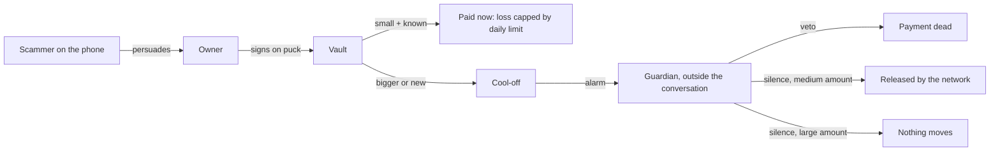

# 07. Threat model

## What we protect, and from whom

- **Asset:** the HBAR and USDC in the vault.
- **Main attacker:** a scammer who never touches the system. He talks the owner into paying (cloned voice, fake bank call, fake investment).
- **Other attackers:** a thief with the puck, a hacked relayer, a hijacked AI agent, a dishonest guardian.

## Version 2 corrections (these replace the rows with the same numbers below)

A red-team review on 5 Oct showed that four answers in the table below were wrong or too optimistic. The corrected answers:

| # | Flaw | Corrected answer | Honest remainder |
|---|---|---|---|
| 3 | "Silence means yes." | Nothing leaves on silence any more. A WAIT payment needs the owner's second confirmation after half the cool-off; an APPROVAL payment needs a guardian's yes. | An owner who is still convinced after the wait will confirm. The guardian is then the only check. |
| 5 | "Stolen puck." | 3-digit PIN (`HISN_PIN_LEN`, 6 for production), wipe after 10 tries. With the PIN, a thief can make instant payments inside the two-day cap, and can start waiting payments and changes, each of which alarms the guardian and can be stopped. | A key read out of the flash chip gives the same powers. Loss without the guardian noticing is capped at the instant limit. |
| 13 | "Dishonest or stolen guardian." | One guardian key can stop and freeze. It cannot pay, cannot be a payee, and cannot recover the puck: that needs a second, different guardian plus a long wait the owner can cancel. Freezes expire. The owner can remove a guardian alone after a long wait. | A hostile guardian can block waiting payments until removed. Two colluding guardians could take the vault after the recovery delay if the owner never looks at her puck. |
| 20 | "Replay." | Nonce, vault, chain id and action code are in every digest; `epoch` is in FREEZE; `keyEpoch` is in CHANGE; deadlines are capped at 600 s. | None known. |
| 11 | "Relayer." | The relayer cannot move or block money. It does carry alerts and the agent's key. The guardian page is hosted separately and reads the chain itself; the light ignores unsigned "clear" messages. | A dead relayer stops new payments and the light's alerts; a hacked relayer can spend the agent's daily allowance. We no longer say "no company in the middle". |

New flaws found and fixed are listed in `12-red-team-fixes.md`, section A. What is still not solved is in section E of that file.

## Hostile-jury flaws and our answers

| # | Flaw | Our answer | Honest remainder |
|---|---|---|---|
| 1 | "Delay plus guardian already exists: Argent, Coinbase Vault, Safe + Zodiac Delay, Monzo, Revolut." | Agreed, we do not claim the idea. Three differences: the **network** releases the payment (no keeper, no custodian); the guardian is a **physical alarm** in another person's hands; the owner approves on a **device screen** that a fake web page cannot alter. Those products mostly defend against a stolen key. We defend against a persuaded owner. | The logic is close to Zodiac Delay. The novelty is the combination and the target. |
| 2 | "Term Finance: governance set the cooldown to zero." | `SETTINGS_DELAY` and `RECOVERY_DELAY` are immutable. The cool-off has an immutable floor. Every rule change needs the puck, a guardian's yes **and** the delay. | If owner and guardian are both fooled for the whole delay, rules can change. |
| 3 | "Silence means yes fails when nobody is watching." | Large payments (APPROVAL tier) need an active yes. SUPERSEDED: see the version 2 corrections above. Nothing releases on silence. | A medium payment can be lost if the guardian ignores the alarm. That is the product's stated limit. |
| 4 | "No recovery if the ESP32 is lost." | `RECOVER_PUCK`: a guardian proposes a new puck, a long delay runs, the old puck can cancel. | The owner is locked out during the delay. |
| 5 | "Stolen puck." | The thief needs the PIN. Ten wrong tries wipe the key. With the PIN he can only pay saved payees inside the daily cap; anything else alarms the guardian, who can freeze. | A 4-digit PIN falls to someone who reads the flash chip. Loss is capped at one day's instant limit. |
| 6 | "Blind signing." | The puck builds the digest from the fields it displays and never signs a supplied hash. Names come from its own memory. | The owner can still fail to read the screen. The guardian exists for that. |
| 7 | "ESP32 is not a secure element." | True, and we say it. The design limits what a stolen key can do. An ATECC608 is a listed upgrade. | A key extracted in a lab can make instant payments up to the cap. |
| 8 | "Custom crypto in an immutable contract." | ECDSA goes through OpenZeppelin. The hash-based check is a separate stateless contract (`HisnPQVerifier`), tested against two independent implementations (TypeScript and C) with shared vectors. It is hybrid: ECDSA is still required, so a bug in the hash-based part cannot let an attacker in without the ECDSA key. | Not audited and simplified (XMSS-style, not SLH-DSA). Labelled so in `docs/QUANTUM.md`. |
| 9 | "The quantum threat is distant." | Maybe, but keys harvested today can be forged later. Moving money needs a hash-based signature from the puck (`docs/QUANTUM.md`). | Guardian, agent and Hedera account keys stay classical; worst cases are listed in `docs/QUANTUM.md`. |
| 10 | "The guardian only sees what the system shows." | The guardian page reads the chain directly and shows the raw address. Labels are marked "saved name". We do no identity check and never say "verified". | A guardian cannot know who really owns a new address. `NEW RECIPIENT` is the honest signal. |
| 11 | "Relayer censorship." | The relayer cannot forge anything. A veto can bypass it (guardian page sends directly). A payment already scheduled is released without it. | A dead relayer blocks **new** payments and the hardware light's alerts until the guardian page picks them up. |
| 12 | "Testnet only." | Required by Tunisian rules. The contract is the same code that would run on mainnet. | No real-money evidence. |
| 13 | "Guardian collusion or a dishonest guardian." | A guardian can stop payments and can start a puck recovery, which the owner cancels with her puck during a long delay. A guardian can never move money alone. | A guardian can freeze the account and be a nuisance. Choose the guardian with care. |
| 14 | "The scammer simply tells the victim to wait three minutes." | The delay is not the defence; the **second person** is. The scammer must now also fool someone who is not on the call. For large sums that person must actively agree. | If the guardian is also fooled, the payment goes. |
| 15 | "The scammer makes himself a saved payee first." | Adding a payee needs a guardian's yes plus `SETTINGS_DELAY`. | Long, patient scams (weeks) can pass both. No delay product solves that. |
| 16 | "Many medium payments." | `waitQueued` adds up waiting payments over today and yesterday; above `waitMax` they need approval. | The window is two days; weekly limits are roadmap. |
| 17 | "Hijacked AI agent." | The agent key works only for saved payees inside `agentDailyMax`, enforced on chain. | Loss of one day's agent allowance, per day, until someone freezes. |
| 18 | "HCS is just your server writing logs." | Messages carry device signatures and anyone can post. The relayer cannot fake a guardian's veto or change the consensus timestamp. | The relayer can omit messages. The contract events remain as the money record. |
| 19 | "Anyone can call `execute`." | Yes, on purpose. It only succeeds after the cool-off, on a live payment, when not frozen. Calling it early reverts. | None. |
| 20 | "Replay of old signatures." | Nonce, deadline, vault address, chain id, action code and epoch are all inside the digest. | None known. |
| 21 | "Reentrancy when paying out." | Status changes before the transfer; `nonReentrant` on every paying function. | None known; covered by a test with a malicious receiver. |
| 22 | "The vault runs out of HBAR for the timer." | `GAS_RESERVE` cannot be spent by payments. If the scheduled call still fails, anyone presses Execute. | The dashboard must warn when the reserve is low. |
| 23 | "Wi-Fi is plain text on the demo hotspot." | Everything that matters is signed and verified on chain. | Someone on the hotspot can see amounts and addresses, which are public on chain anyway. |
| 24 | "Who would bother setting up a guardian?" | Fair. In US brokerage only about 42% of customers named a trusted contact. Our answer is a go-to-market one: wallets and families turn it on at account creation. | Unvalidated. We have spoken to no user. Say so. |

## What we do NOT defend against

- A scam that fools the owner **and** the guardian.
- A scam that keeps payments inside the instant limits for many days.
- Loss of both the puck and every guardian device at once.
- Bugs in Hedera's Schedule Service itself.
- Anyone reading the public chain: there is no privacy.

## Security checks before the demo

1. Run the full contract test suite, including the malicious-receiver test.
2. Try to call every state-changing function with a wrong signer; all must revert.
3. Confirm on HashScan that the deployed vault has **no admin key held by a person** (HashScan should show none, or the contract's own id). Record what it shows.
4. Change one byte of a signed payment and confirm the vault rejects it (Day-1 test 5).
5. Confirm a vetoed payment cannot be executed by hand afterwards.
6. Confirm a payment from before a freeze cannot be executed after an unfreeze.
