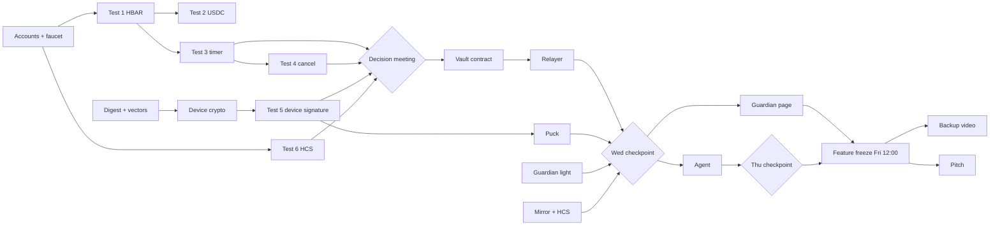

# 08. Tech stack, repo structure and task backlog

> **Version 2 scope (read this first).** After the judge's review the build list was cut. The four checkpoints in `12-red-team-fixes.md`, section D, replace the day-by-day goals below wherever they disagree. In short: Day-1 tests by Tuesday night; the vault with the second-confirmation rule by Wednesday night; guardian light, three live screens and five interviews by Thursday night; the "server off" demo and backup video by Friday noon. Recovery, settings changes on the puck, the People and Protection pages and the hash-based vault are **not built** for Saturday. The agent is built only if Wednesday's checkpoint is met. New tasks: `T14` five user interviews (person C, by Thursday); `T29` guardian page as a separate static site; `T38` `reconfirm` in the contract, relayer and puck.

## Tech stack

| Layer | Choice | Why |
|---|---|---|
| Contracts | Solidity 0.8.24, Hardhat, ethers v6, OpenZeppelin 5 | Most Hedera tutorials use Hardhat; mocks are easy with `hardhat_setCode` |
| Chain access | Hashio JSON-RPC (chain id 296) + `@hashgraph/sdk` for HCS | EVM calls through RPC, HCS through the SDK |
| Backend | Node.js 22, TypeScript, Fastify, `ws`, `better-sqlite3`, Vitest | One language across backend, scripts and dashboard |
| Dashboard and guardian page | React, Vite, Tailwind, ethers v6 | Fast to build; the guardian page signs in the browser |
| Firmware | PlatformIO, Arduino framework, C++ | You already have PlatformIO installed |
| Agent | LLM API with tool calls, inside the backend | No extra service to run |
| Package manager | pnpm workspaces | One install for all TypeScript packages |

## Repo structure

```
hisn/
├── docs/ENGINEERING_RULES.md     hard rules for the repo
├── README.md                     how to run everything in 10 minutes
├── .env.example
├── .gitignore                    .env, node_modules, .pio, *.db
├── package.json                  pnpm workspace root
├── pnpm-workspace.yaml
├── docs/                         these design files
│   ├── DAY1_RESULTS.md           pass/fail log of the six tests, with HashScan links
│   └── UNVERIFIED.md             running list, copied from the design README
├── shared/
│   ├── abi/HisnVault.json        copied from contracts after each build
│   ├── src/digest.ts             the ONE TypeScript implementation of the digests
│   ├── src/units.ts              hbarToWei, formatAmount, token table
│   ├── src/hcs.ts                HCS message types and validator
│   └── test-vectors.json         generated by scripts/gen-vectors.ts
├── contracts/
│   ├── hardhat.config.ts         networks: hardhat, hederaTestnet (296)
│   ├── contracts/
│   │   ├── HisnVault.sol
│   │   ├── HisnVaultPQ.sol       COULD tier
│   │   ├── interfaces/IHederaScheduleService.sol
│   │   ├── interfaces/IHRC719.sol
│   │   └── mocks/ MockScheduleService.sol, MockUSDC.sol, EvilReceiver.sol
│   ├── test/
│   │   ├── vault.pay.test.ts     tiers, limits, replay, deadlines
│   │   ├── vault.veto.test.ts    veto, cancel, approve, expiry
│   │   ├── vault.freeze.test.ts  freeze, epoch, unfreeze
│   │   ├── vault.change.test.ts  settings and both recoveries
│   │   ├── vault.agent.test.ts
│   │   ├── vault.schedule.test.ts  mock success, busy second, total failure
│   │   └── vectors.test.ts       digests equal shared/test-vectors.json
│   └── scripts/
│       ├── day1/01_hbar_payout.ts ... 06_hcs_log.ts
│       ├── deploy.ts             deploy, associateToken, fund, create topic, write .env
│       └── gen-vectors.ts
├── backend/
│   └── src/
│       ├── index.ts              Fastify + WebSocket server
│       ├── chain/vault.ts        ethers contract wrapper, nonce queue, gas limits
│       ├── chain/mirror.ts       event poller with cursor
│       ├── chain/hcs.ts          submit and read topic messages
│       ├── sig.ts                normalise s, find v, verify signer
│       ├── devices.ts            device WebSocket protocol
│       ├── routes/               state, payments, requests, relay, fallback, agent, export
│       ├── agent/                loop, tools, prompt
│       └── db.ts
├── dashboard/
│   └── src/
│       ├── pages/ Home, NewPayment, PaymentDetail, Rules, Agent, SideBySide, Log
│       ├── pages/Guardian.tsx    phone page with its own key
│       ├── lib/mirror.ts         direct mirror-node reader
│       └── components/ Timeline, CountdownRing, StatusTile, DeviceDots
├── firmware/
│   ├── lib/hisn_crypto/          keccak, digests, sign, format (shared by both devices)
│   ├── puck/                     platformio.ini, src/main.cpp, ui.cpp, store.cpp, net.cpp
│   ├── guardian/                 platformio.ini, src/main.cpp
│   └── test/test_vectors/        native unit test against shared/test-vectors.json
└── demo/
    ├── runbook.md                the 60-second script, with who presses what
    ├── reset.ts                  puts the vault and devices back to the start state
    ├── scam-call.mp3             the SIMULATED voice call, labelled
    └── backup-video.mp4
```

## Who does what

Roles are placeholders until you assign names.

- **A = chain.** Contracts, deploy scripts, Day-1 tests, relayer chain code.
- **B = devices.** Both firmwares, the shared crypto library, wiring, enclosures.
- **C = experience.** Dashboard, guardian page, agent, HCS timeline, pitch, video.

## Backlog

Deadline: Saturday 19:00. `->` means "needs this first".

### Day 1: Monday evening and Tuesday 6 Oct. Goal: all six tests have an answer.

| ID | Task | Who | Needs |
|---|---|---|---|
| T01 | Create three testnet accounts (ECDSA) at portal.hedera.com; fill `.env`; collect USDC from the Circle faucet every 2 hours, starting now | A | |
| T02 | Repo skeleton, pnpm workspace, Hardhat config for chain 296, engineering rules in place | A | |
| T03 | **Day-1 test 1:** minimal vault pays out HBAR | A | T01, T02 |
| T04 | **Day-1 test 2:** vault associates USDC, receives it, sends it | A | T03 |
| T05 | **Day-1 test 3:** vault schedules its own `execute`, it fires; record gas and timing | A | T03 |
| T06 | **Day-1 test 4:** `deleteSchedule` cancels it | A | T05 |
| T07 | `shared/src/digest.ts` and `gen-vectors.ts`, producing `test-vectors.json` | A | T02 |
| T08 | `hisn_crypto` library passes the test vectors in a native test | B | T07 |
| T09 | **Day-1 test 5:** ESP32 signs a PAY message; a tiny contract's `ecrecover` accepts it and rejects a one-byte change | B + A | T08, T03 |
| T10 | **Day-1 test 6:** create an HCS topic, post two messages, read them back with consensus timestamps | C | T01 |
| T11 | Wire both devices: OLED, buttons, LED, buzzer; "hello" firmware with Wi-Fi and WebSocket | B | |
| T12 | Dashboard skeleton with mock data: Home, Payment detail, timeline component | C | T02 |
| T13 | Write `docs/DAY1_RESULTS.md`. **Decision meeting:** if test 3 fails, switch to the manual-execute fallback today | all | T03 to T10 |

### Day 2: Wednesday 7 Oct. Goal: one real payment flows end to end.

| ID | Task | Who | Needs |
|---|---|---|---|
| T20 | `HisnVault.sol`: propose, tiers, execute, veto, cancel, approve, freeze + mocks + tests | A | T13 |
| T21 | Settings changes and both recoveries + tests | A | T20 |
| T22 | `deploy.ts`: deploy, associate, fund, create topic, write `.env` | A | T20 |
| T23 | Relayer: device WebSocket, `sig.ts`, `POST /requests`, `propose` path | A | T20 |
| T24 | Puck firmware: Review, PIN, sign, send; encrypted key storage | B | T09 |
| T25 | Guardian light firmware: alert, alarm states, veto with 2 s hold, ack | B | T11 |
| T26 | Relayer: mirror poller, alerts, veto and approve relay, HCS posting | C | T10, T23 |
| T27 | Dashboard on live data: New payment, Payment detail with countdown and HashScan links | C | T23 |
| T28 | **Checkpoint, Wednesday night:** dashboard request, puck signs, vault waits, light beeps, veto works, on testnet. If not, the agent becomes a scripted demo. | all | T20 to T27 |

### Day 3: Thursday 8 Oct. Goal: complete MUST tier, start SHOULD.

| ID | Task | Who | Needs |
|---|---|---|---|
| T30 | Guardian page: own key, mirror reading, veto, approve, freeze, direct-send fallback | C | T28 |
| T31 | Rules screen and change flow (propose, approve, apply) | C | T21 |
| T32 | Payee labels on the puck, `NEW RECIPIENT`, freeze from the puck menu | B | T24 |
| T33 | Agent: `agentPay` in the vault + tests, tools, prompt, Agent screen | A + C | T28 |
| T34 | Side-by-side demo screen and `demo/reset.ts` | C | T27 |
| T35 | Manual-execute fallback route and button | A | T23 |
| T36 | Enclosures: boxes, labels, a big red veto button, battery packs | B | T25 |
| T37 | **Checkpoint, Thursday night:** agent pays one bill and is refused once, on testnet. If not, the agent becomes a slide. | all | T33 |

### Day 4: Friday 9 Oct. Goal: freeze features at noon, then rehearse.

| ID | Task | Who | Needs |
|---|---|---|---|
| T40 | "Unplug the laptop" proof: record it | A | T28 |
| T41 | Lost-puck recovery test on testnet (not in the live demo) | A | T21 |
| T42 | Quantum side demo (`HisnVaultPQ`), **only** if T28, T30 to T35 are done | A or B | all above |
| T43 | Evidence export button (only if spare time) | C | T26 |
| T44 | **Feature freeze at 12:00** | all | |
| T45 | Record the backup video of the full demo | C | T44 |
| T46 | Pitch deck, 6 slides; rehearse three times with a stopwatch | C + all | T44 |
| T47 | Repo README, setup steps, architecture image, licence | A | T44 |
| T48 | Security checks from `07-threat-model.md` | A | T44 |
| T49 | First 4Hacks submission (it can be edited later) | C | T45 to T47 |

### Day 5: Saturday 10 Oct. Goal: nothing new.

| ID | Task | Who |
|---|---|---|
| T50 | Top up vault gas reserve, relayer HBAR and USDC; run `demo/reset.ts` | A |
| T51 | Two full rehearsals on the venue network; charge batteries; spare cables | all |
| T52 | Final submission edit by 17:00, two hours before the deadline | C |

## Dependency picture



## Risk list for the plan

| Risk | Sign | Response |
|---|---|---|
| Test 3 fails | No scheduled execution after two hours of trying | Manual-execute fallback; change the pitch line to "contract-enforced delay" and be honest |
| ESP32 crypto does not build | T08 still red on Tuesday night | Sign on the ESP32 with a different library (Trezor crypto subset), or as a last resort sign in a phone app and keep the ESP32 as display and button |
| Hashio rate limits | Random RPC errors | Retries; a second RPC provider in `.env` |
| USDC shortage | Faucet gives 20 per 2 hours | Start collecting on Monday; demo with 100 USDC; HBAR as backup asset |
| One person blocked | A task open for more than half a day | Swap or cut at the next checkpoint |
